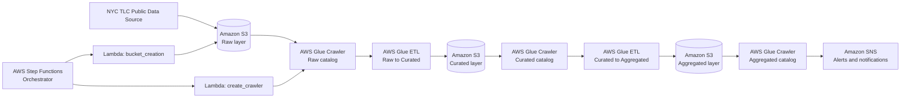

# NYC TLC Data Pipeline

A cloud-native ETL and analytics pipeline for ingesting, cleaning, cataloging, and aggregating NYC TLC trip data using Amazon S3, AWS Glue, AWS Lambda, AWS Step Functions, and Amazon SNS.

This project automates the full lifecycle of public NYC TLC trip data:

- downloads trip files from the TLC public source
- stores raw source data in S3
- creates metadata and crawler definitions in AWS Glue
- validates and transforms raw records into curated datasets
- aggregates trip data by borough, zone, and service pattern
- orchestrates the workflow with Step Functions
- sends success/failure alerts through SNS

---

## Project at a glance

- Data source: NYC Taxi & Limousine Commission trip records
- Storage: Amazon S3
- Transformation: AWS Glue ETL with PySpark
- Metadata catalog: AWS Glue Data Catalog
- Orchestration: AWS Step Functions
- Notification: Amazon SNS
- Modes supported: Historical and Current (incremental monthly refresh)

---

## Why this project exists

The pipeline follows a medallion-style lakehouse approach:

- Raw layer: original files downloaded from the TLC source
- Curated layer: cleaned, normalized, validated trip records
- Aggregated layer: daily analytical summaries for reporting and BI

This design supports both:

- Historical mode: first-time full backfill of available data
- Current mode: monthly incremental refreshes for ongoing ingestion

The business value is straightforward: NYC TLC data becomes query-ready and continuously refreshable for reporting, trend analysis, and operational insight without manual processing.

---

## Architecture overview



The workflow is orchestrated by AWS Step Functions, with Lambda functions used for bootstrap tasks and Glue jobs handling the data processing stages.

---

## Repository structure

```text
nyc_tlc_project/
├── bucket_creation.py
├── create_crawler.py
├── data_download_upload.py
├── raw_to_curated_nyc_tlc_bookmark.py
├── curated_to_aggregated_nyc_tlc_bookmark.py
├── README.md
└── .git/
```

### File responsibilities

- `bucket_creation.py`  
  Creates the project S3 bucket if it does not already exist.

- `create_crawler.py`  
  Creates the Glue database, IAM role, and crawlers for the raw, curated, and aggregated layers.

- `data_download_upload.py`  
  Downloads the NYC TLC parquet files and uploads them to the raw data lake layer.

- `raw_to_curated_nyc_tlc_bookmark.py`  
  Reads raw HVFHV files, normalizes them, validates quality rules, and writes curated parquet output.

- `curated_to_aggregated_nyc_tlc_bookmark.py`  
  Enriches the curated data with taxi zone metadata and creates summary aggregation tables.

- AWS Step Functions orchestration  
  Coordinates the overall ETL workflow across bucket setup, Glue setup, data ingestion, transformation, aggregation, and notifications.

---

## Data flow

### 1) S3 bucket setup

The workflow begins by creating the bucket using the naming convention:

```text
nyc-tlc-<account_id>
```

Example:

```text
nyc-tlc-123456789012
```

This is created by `bucket_creation.py` and is the first Task in the step function.

---

### 2) Glue setup and catalog initialization

The next step prepares the Glue environment using `create_crawler.py`.

It creates:

- the Glue database (`nyc_tlc_db` by default)
- the IAM role required for Glue jobs and S3 access
- required Glue crawlers for the data sources and transformed outputs

Configured crawlers include:

- `nyc-tlc-crawler` → raw HVFHV data
- `zone-crawler-for-nyc-tlc` → raw zone lookup data
- `nyc-tlc-curated-crawler` → curated HVFHV data
- `nyc-tlc-aggregated-crawler` → aggregated output

---

### 3) Raw ingestion

The raw ingestion stage is implemented by `data_download_upload.py`.

This job:

- detects the latest available month of NYC TLC trip data
- downloads the corresponding parquet files from the TLC CDN
- uploads data to the raw S3 layer
- writes the NYC taxi zone lookup CSV into the raw zone lookup path

Example raw paths:

```text
s3://nyc-tlc-<account_id>/raw/hvfhv/year=2025/month=01/
s3://nyc-tlc-<account_id>/raw/zone_lookup/taxi_zone_lookup.csv
```

The job accepts a Glue argument called `jobtype`:

- `historical` → full backfill for historical data
- `current` → latest-month incremental ingestion

This is the raw/bronze layer of the architecture.

---

### 4) Raw-to-curated transformation

The transformation job `raw_to_curated_nyc_tlc_bookmark.py` converts raw HVFHV trip records into a curated, analysis-ready layer.

It performs:

- type casting and normalization
- timestamp/date cleaning
- data validation and filtering
- fare and trip metrics calculation
- generation of derived flags
- month/year partitioning for efficient downstream queries

Example curated output path:

```text
s3://nyc-tlc-<account_id>/curated/hvfhv/year=2025/month=01/
```

Key quality checks include:

- null pickup/dropoff timestamps
- null zone IDs
- invalid or impossible trip durations
- negative trip mileage or fares
- invalid license categories
- dropoff time earlier than pickup time

This creates the curated/silver layer used for analytics.

---

### 5) Curated-to-aggregated reporting tables

The aggregation job `curated_to_aggregated_nyc_tlc_bookmark.py` joins the curated trip data with the taxi zone reference file and creates business-level analytics tables.

It generates three main output datasets:

1. `daily_borough`
   - daily trip summary by pickup/dropoff borough
   - includes trip count, total revenue, total distance, and total duration

2. `daily_zone`
   - daily summary by pickup/dropoff zone and airport flag
   - useful for spatial analysis and trip movement patterns

3. `daily_service`
   - summary by service patterns such as shared rides and WAV usage

Output paths:

```text
s3://nyc-tlc-<account_id>/aggregated/daily_borough/
s3://nyc-tlc-<account_id>/aggregated/daily_zone/
s3://nyc-tlc-<account_id>/aggregated/daily_service/
```

These gold-layer tables are intended for dashboards, KPI analysis, and downstream BI workloads.

---

### 6) Workflow orchestration with Step Functions

The pipeline is orchestrated by AWS Step Functions in the following sequence:

1. create the S3 bucket
2. configure the required Glue crawlers and metadata
3. download and upload the raw NYC TLC files
4. start raw and zone crawlers in parallel
5. run the raw-to-curated transformation
6. crawl the curated layer
7. run the curated-to-aggregated transformation
8. crawl the aggregated layer
9. publish the workflow outcome through SNS
10. terminate in success or failure state

The workflow includes retry handling and failure capture. On error:

- the failure is captured in the Step Functions execution state
- a notification path is triggered
- an SNS alert is sent
- the workflow ends in a failed execution state

On success, the workflow completes successfully.

---

## Historical vs current mode

The ETL scripts are designed around a consistent two-mode operating pattern.

### Historical mode

Use it for the initial full backfill.

- reads all available raw partitions
- rebuilds curated data from scratch
- rebuilds aggregated results from scratch
- writes with overwrite semantics

This is the bootstrap mode for a new environment.

### Current mode

Use it for routine monthly updates.

- reads only newly added data
- uses bookmark-aware incremental processing
- avoids reprocessing the full historical dataset
- is intended for recurring scheduled runs

The mode is selected by the Glue job argument:

```text
--jobtype=historical
```

or

```text
--jobtype=current
```

---

## AWS services used

- Amazon S3 — storage for raw, curated, and aggregated datasets
- AWS Lambda — bucket creation and crawler setup
- AWS Glue — ETL jobs, crawler automation, and metadata catalog
- AWS Step Functions — workflow orchestration and state management
- Amazon SNS — pipeline notifications and failure alerts

---

## Prerequisites

Before deploying this pipeline, ensure the following are available in the target AWS account:

- valid AWS credentials or an execution role with required permissions
- AWS Lambda functions for the bucket creation and crawler setup steps
- AWS Glue jobs for the ETL stages
- SNS topic for pipeline notifications
- access to create/read/write S3 objects and Glue metadata

---

## Typical execution flow

A standard run looks like this:

1. Start the Step Functions orchestration
2. S3 bucket is created automatically if it does not exist
3. Glue database and crawlers are created or validated
4. latest TLC parquet files are downloaded
5. raw data is crawled into the Glue catalog
6. raw-to-curated transformation runs
7. curated data is crawled
8. aggregated daily summary tables are created
9. aggregated output is crawled
10. an SNS success or failure notification is published

---

## Business value and output

This project turns public TLC trip data into an operational analytics foundation. It enables:

- trend analysis across time and geography
- borough, zone, and service-level KPI tracking
- cleanup and validation of messy source feeds before analysis
- repeatable monthly ingestion without manual intervention
- a structured lakehouse pattern suitable for downstream BI tools and analytics workloads

---

## Expected output

After a successful run, the project creates:

```text
raw/hvfhv/...                 -> downloaded raw trip files
raw/zone_lookup/...           -> taxi zone lookup data
curated/hvfhv/...            -> cleaned, validated trip records
aggregated/daily_borough/     -> daily borough summaries
aggregated/daily_zone/       -> daily zone-based summaries
aggregated/daily_service/    -> service-level summaries
```

These outputs can be consumed by Athena, Glue, dashboards, and downstream analytics tools.

---

## Quick deployment notes

- This project is built for AWS-managed services and assumes an AWS execution environment.
- Bucket names are account-specific, so separate AWS accounts or environments should use their own bucket naming.
- `historical` is intended for initialization; `current` is intended for month-to-month pipeline refreshes.
- The workflow is designed for automation rather than manual notebook-based execution.

---

## Summary

This repository implements a robust, automated NYC TLC analytics pipeline on AWS. It covers the full lifecycle of public transportation data: ingestion, metadata registration, validation, transformation, aggregation, and alerting. It is suitable for both initial data backfills and ongoing monthly refreshes in a cloud-native data engineering stack.
